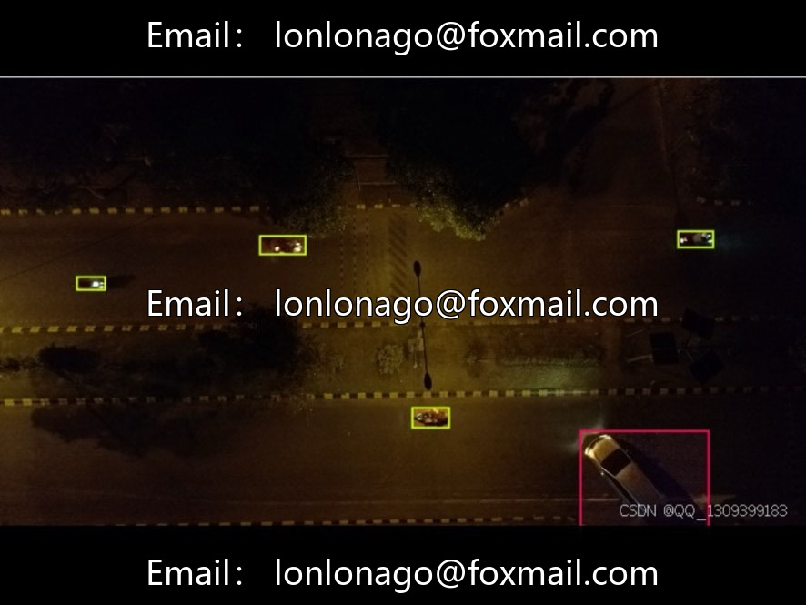
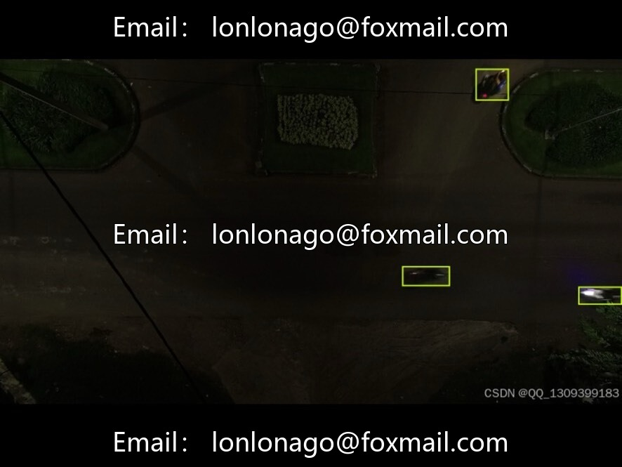
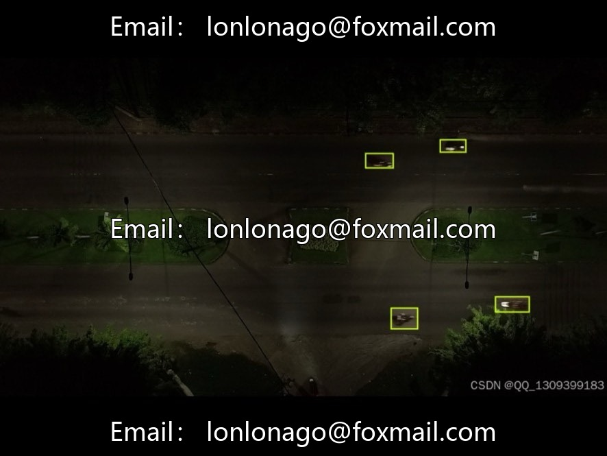
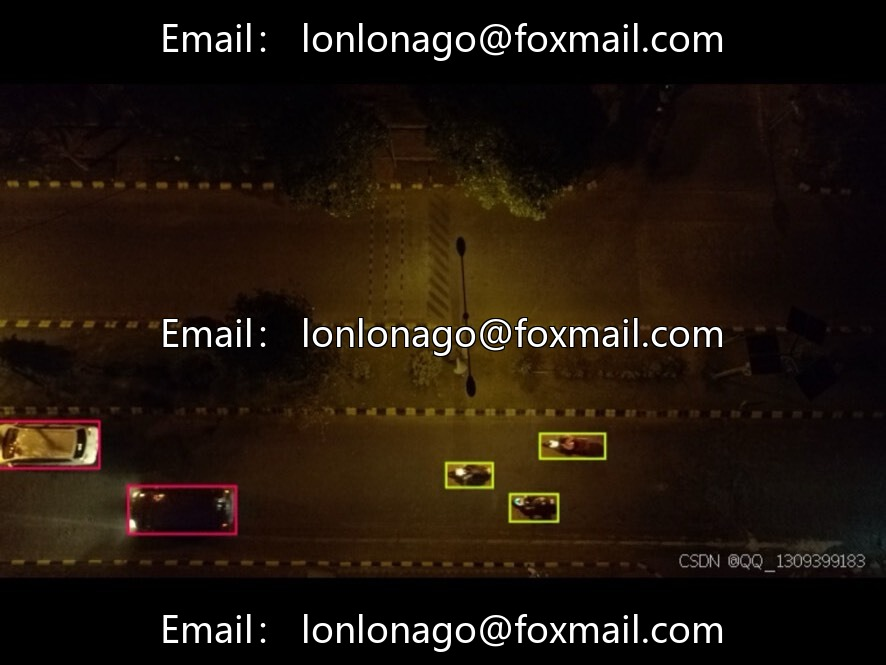

# Nighttime low light aerial vehicle target detection dataset | Issue 10070

## Body

Night low light aerial vehicle target detection dataset | Issue 10070

Containing 2302 nighttime road aerial images, focusing on vehicle recognition, suitable for intelligent transportation, autonomous driving night perception and other scenarios.

The dataset is divided into 1656 training sets, 430 validation sets, and 216 test sets, with clear structures, facilitating model training and evaluation.

Image resolution 1280×720, annotation information in JSON format, recording target ID, category and coordinates. The original data and annotation are stored separately to ensure integrity.

Virtual materials, once sold, are non-refundable.
Interested friends, click "I want" to proceed.

## Images

## Payment

Here is a pay link on Stripe ( https://buy.stripe.com/3cs8yP7sY87d0vu9AB ). Please contact me lonlonago@foxmail.com after funding $89, and I will send you a complete data files , thank you!

